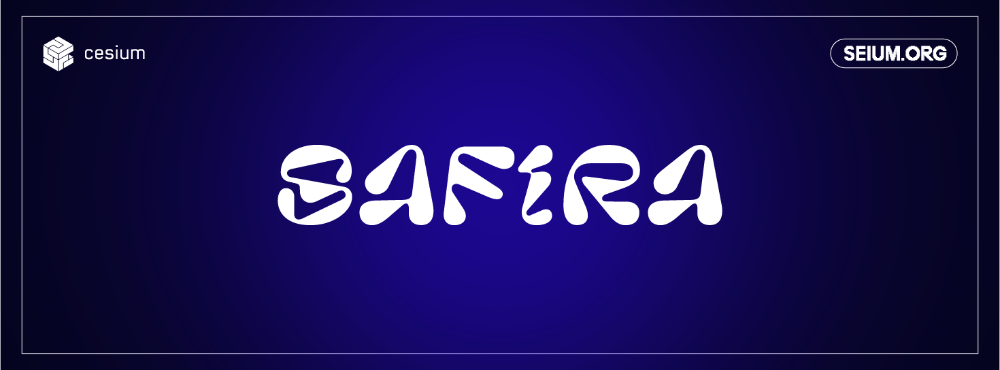

[contributing]: CONTRIBUTING.md
[code_of_conduct]: CODE_OF_CONDUCT.md
[license]: LICENSE
[ci-test-status]: https://github.com/cesium/safira/actions/workflows/test.yml/badge.svg
[ci-test-workflow]: https://github.com/cesium/safira/actions/workflows/test.yml
[ci-style-status]: https://github.com/cesium/safira/actions/workflows/style.yml/badge.svg
[ci-style-workflow]: https://github.com/cesium/safira/actions/workflows/style.yml
[figma-design-2022]: https://www.figma.com/file/sPqEvYKlOqL8L7CC2AzxkN/SEI
[figma-badge-2022]: https://img.shields.io/badge/-figma22-s?style=flat&logo=figma&color=black
[figma-design-2021]: https://www.figma.com/file/1phER5eukGFC5p9tFGnfk7/SEI
[figma-badge-2021]: https://img.shields.io/badge/-figma21-s?style=flat&logo=figma&color=black

# Safira

[![CI Test][ci-test-status]][ci-test-workflow]
[![CI Style][ci-style-status]][ci-style-workflow]
[![Design 2022][figma-badge-2022]][figma-design-2022]
[![Design 2021][figma-badge-2021]][figma-design-2021]

Safira is the platform behind [SEI](https://seium.org/), the Semana da
Engenharia Informática organized every year by CeSIUM at UMinho. Built with
[Elixir](https://elixir-lang.org/) and
[Phoenix LiveView](https://hexdocs.pm/phoenix_live_view), it is where attendees
follow the event's schedule, enrol in activities and collect badges by
visiting companies, attending talks and completing challenges.

Badges earn attendees tokens, which they can spend in the store or in
minigames such as the wheel, slots, coin flip and scratch cards, while
competing on the leaderboard for prizes. Companies have their own dashboard to
scan attendees and award badges, and the organization manages everything,
from attendees and staff to the schedule, store, prizes and final draw,
through a backoffice.

## 🤝 Contributing

When contributing to this repository, please first discuss the change you wish
to make via discussions, issue, email, or any other method with the owners of
this repository before making a change.

Please note we have a [Code of Conduct][code_of_conduct], please follow it
in all your interactions with the project.

We have a [Contributing Guide][contributing] to help you getting started.

## 📝 License

Copyright (c) 2026, CeSIUM.

This project is licensed under the MIT License - see the [LICENSE][license]
file for details.
